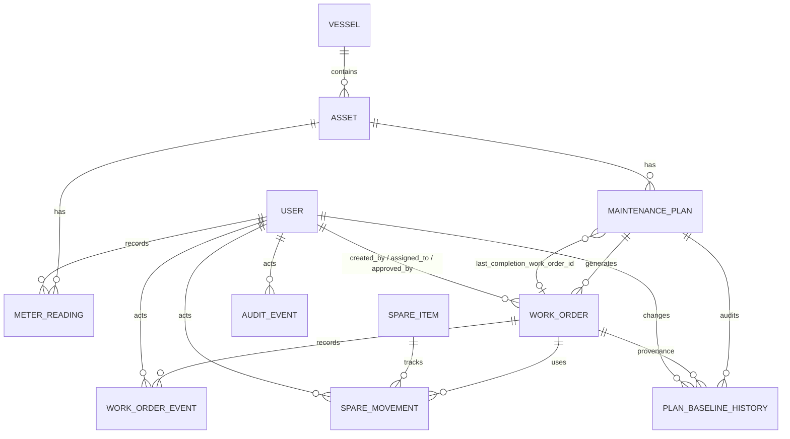

# Phase 2 — Completion Report

**Project:** Shipyard CMMS — MNA4003 (FE-MNA4003-S12026-2027)
**Student ID:** **S79244**
**Phase:** 2 — Database schema, seed data and integrity constraints
**Date:** 24 November 2026
**Verdict:** **PASS**

**Protected documents preserved unchanged:** `docs/requirements-analysis.md`, `docs/proposed-system-modules.md`, `docs/implementation-plan.md` (verified by diff). The lecturer's original materials remain tracked and untouched. No commit or push performed.

---

## 1. Implementation summary

Phase 2 delivers the complete relational foundation of the CMMS on PostgreSQL 18: 4 new native enum types, 11 domain tables, 3 circularity-resolving foreign keys, the partial unique index that atomically prevents duplicate active work orders per plan, append-only triggers for historical tables, a monotonic meter-reading trigger, and deterministic, repeatable seed data matching the approved counts (1 vessel, 10 assets, 8 plans, 6 work orders, 6 spares, 5 users). Phase 1 authentication, RBAC and tests remain intact (21/21 still pass).

## 2. Database tables and relationships

### 2.1 Tables (15 total, including 4 framework tables)

| Table | PK | Notes |
|---|---|---|
| `users` (Phase 1) | uuid | native `user_role` enum |
| `vessels` | uuid | 1 row seeded |
| `assets` | uuid | 10 rows, 8 subsystems |
| `meter_readings` | uuid | 16 rows |
| `maintenance_plans` | uuid | 8 rows |
| `work_orders` | uuid | 6 rows |
| `work_order_events` | uuid | 19 rows |
| `spare_items` | uuid | 6 rows |
| `spare_movements` | uuid | 11 rows |
| `plan_baseline_history` | bigserial | 2 rows |
| `audit_events` | bigserial | 5 rows |
| `sessions`, `password_reset_tokens`, `cache*`, `jobs*` | (framework) | |

### 2.2 Entity relationship diagram (Mermaid)



### 2.3 Relationships (foreign keys)

All domain FKs use `ON DELETE RESTRICT` except:
- `maintenance_plans.last_completion_work_order_id` → `work_orders.id` `ON DELETE SET NULL` (provenance link, optional).
- `work_order_events.work_order_id` → `work_orders.id` `ON DELETE CASCADE` (events are part of the work order's lifecycle and are removed with it).

## 3. Constraints and indexes

### 3.1 Native enum types

`criticality` (`low, medium, high, critical`), `service_status` (`in_service, standby, withdrawn`), `plan_trigger` (`calendar, hours, dual`), `work_order_state` (`open, in_progress, submitted, closed`), plus `user_role` from Phase 1. PHP backed enums mirror them under `App\Enums`.

### 3.2 CHECK constraints

- `assets.meter_unit = 'hours'`
- `maintenance_plans`: `interval_days > 0`, `interval_hours > 0`, `last_completion_hours >= 0`, trigger/interval coherence, and `chk_plan_activation_complete` (active plan requires all applicable baselines)
- `work_orders`: closed ⇒ `closed_at` not null; submitted ⇒ `submitted_at` not null; `actual_completion_hours >= 0`
- `work_order_events`: `event_type` in the six allowed values; `returned` ⇒ non-empty trimmed `reason`
- `spare_items`: `quantity_on_hand >= 0`, `reorder_level >= 0`
- `spare_movements`: `quantity_delta <> 0`; `balance_after >= 0`; issue ⇒ negative delta and `work_order_id` not null; receipt/return ⇒ positive delta; adjustment ⇒ `reason` not null
- `meter_readings`: `reading_hours >= 0`

### 3.3 Partial unique index (critical)

```sql
CREATE UNIQUE INDEX one_active_work_order_per_plan
    ON work_orders (plan_id)
    WHERE state IN ('open', 'in_progress', 'submitted');
```

Verified at the database level: a second active row for the same plan raises `SQLSTATE 23505` on `one_active_work_order_per_plan`. Closed orders are excluded, so a new instance can be created later.

### 3.4 Triggers

- `meter_readings_no_decrease` (BEFORE INSERT/UPDATE): rejects a reading below the highest existing reading for the same asset.
- `prevent_mutation` (BEFORE UPDATE/DELETE) on `audit_events`, `plan_baseline_history`, `work_order_events`, `spare_movements`: makes these tables append-only.

### 3.5 Other indexes

`assets (subsystem, criticality, service_status)`, `meter_readings (asset_id, reading_at DESC, id DESC)`, `maintenance_plans (asset_id, is_active)`, `work_orders (plan_id, state, assigned_to+state, created_at DESC)`, `work_order_events (work_order_id, occurred_at)`, `spare_movements (spare_item_id+occurred_at, work_order_id)`, `audit_events (entity_type, entity_id, occurred_at DESC, actor_id, occurred_at DESC)`.

### 3.6 Exact decimal types

All running hours and stock quantities use `numeric(12,2)` (Laravel `decimal(12,2)`), never floats.

## 4. Seed data inventory

| Entity | Count | Notes |
|---|---|---|
| Vessel | 1 | *Training Vessel Seri Ilmu* (fictional) |
| Assets | 10 | A01–A10 across 8 subsystems |
| Maintenance plans | 8 | 3 calendar, 3 running-hour, 2 dual-trigger |
| Work orders | 6 | 1 Open, 1 In progress, 2 Submitted, 2 Closed |
| Spare items | 6 | includes one below reorder level (SP-005) and one short for the shortage demo (SP-006) |
| Users | 5 | 1 CE, 2 Technicians, 1 Viewer, 1 inactive (Phase 1) |
| Meter readings | 16 | 2 per hour-meter asset |
| Work order events | 19 | includes a returned-then-resubmitted submission (WO-0003) |
| Spare movements | 11 | covers issue, return, receipt and adjustment |
| Plan baseline history | 2 | one per closed work order |
| Audit events | 5 | closure and baseline-advance records |

Re-running `php artisan db:seed` is idempotent: counts are unchanged (verified).

## 5. Migration verification evidence

- `php artisan migrate --force` applied all 13 Phase 2 migrations to `cmms` without error (batch 3).
- `php artisan migrate:status` shows all 16 migrations (3 Phase 1 + 13 Phase 2) as `Ran`.
- `migrate:fresh --seed --force` succeeds on `cmms_test` and reproduces every count in §4.
- Re-running the seeder on an already seeded database leaves counts unchanged.

## 6. Database integrity test results

Command: `docker compose exec app php artisan test --compact`

```
Tests:    50 passed (140 assertions)
Duration: 8.01s
```

Breakdown:

| Suite | Tests | Assertions |
|---|---|---|
| Phase 1 (Authentication, Authorization, UserSeeder, DatabaseConnection, UserRole, Example) | 21 | 74 |
| Phase 2 DatabaseSchemaTest | 5 | 12 |
| Phase 2 SeedDataTest | 7 | 17 |
| Phase 2 DatabaseIntegrityTest | 12 | 25 |
| Phase 2 ModelRelationshipTest | 5 | 12 |

Integrity cases verified against the real PostgreSQL engine (raw SQL, not only Laravel validation):
- duplicate asset code rejected (unique constraint)
- `interval_days = 0` rejected
- active plan without a complete baseline rejected (`chk_plan_activation_complete`); inactive incomplete plan allowed
- negative `quantity_on_hand` rejected
- issue movement with a positive delta rejected
- returned event without a reason rejected
- second active work order for the same plan rejected by `one_active_work_order_per_plan`
- `closed` state without `closed_at` rejected
- `audit_events` update rejected by the append-only trigger
- meter reading below the previous reading rejected by trigger
- deleting a vessel that owns an asset rejected (RESTRICT)
- schema: required tables, enum types, partial index, UUID and bigint primary keys

## 7. Phase 1 regression results

All 21 Phase 1 tests still pass after the Phase 2 changes; no Phase 1 file was modified except the models/enums additions. HTTP behaviour from the Phase 1 report (login per role, 403 on `/admin/users`, logout, inactive rejection) was not re-run this phase but the underlying middleware and routes are unchanged.

## 8. Database backup and isolation evidence

- **Backup created before migration:** `backups/cmms-pre-phase2-20261124-170309.dump` (custom format, 18 KB), stored outside `pgdata` and ignored by Git (`/backups/`).
- **Isolation (positive):** `DatabaseConnectionTest` asserts the suite runs on `pgsql` against database `cmms_test`; all 50 tests pass while using `RefreshDatabase`.
- **Isolation (negative):** an ordered snapshot of the development database (name, server version, migration list, all 5 users, domain table counts) was taken before and after a full test run — **byte-identical**. Development data: `cmms`, PostgreSQL 18.7, 16 migrations, 5 users, 1 vessel, 10 assets, 8 plans, 6 work orders, 6 spares.
- **Safety gates intact:** both Phase 1 gates (`tests/bootstrap.php` and `tests/TestCase::setUp()`) remain; `DB_TEST_DATABASE=cmms` is refused and a cached configuration is refused.

## 9. Files created and modified

Created:
- 13 migrations under `database/migrations/2026_11_24_170316_…_170328_…`
- 6 enums: `app/Enums/{Criticality,ServiceStatus,PlanTrigger,WorkOrderState,WorkOrderEventType,MovementType}.php`
- 10 models: `app/Models/{Vessel,Asset,MeterReading,MaintenancePlan,WorkOrder,WorkOrderEvent,SpareItem,SpareMovement,PlanBaselineHistory,AuditEvent}.php`
- 10 factories: `database/factories/{Vessel,Asset,MeterReading,MaintenancePlan,WorkOrder,WorkOrderEvent,SpareItem,SpareMovement,PlanBaselineHistory,AuditEvent}Factory.php`
- 8 seeders: `VesselSeeder`, `AssetSeeder`, `MeterReadingSeeder`, `MaintenancePlanSeeder`, `WorkOrderSeeder`, `SpareItemSeeder`, `SpareMovementSeeder` plus updated `DatabaseSeeder`
- 4 tests: `DatabaseSchemaTest`, `SeedDataTest`, `DatabaseIntegrityTest`, `ModelRelationshipTest`

Modified:
- `app/Models/User.php` — added `HasMany` relationships to the new domain tables
- `docs/decision-log.md` — appended a developer-tooling section (pre-existing, preserved) and a Phase 2 note

No Phase 1 controller, route, middleware, view or test was changed.

## 10. Technical decisions and deviations

1. **`from_state`/`to_state` as `work_order_state` enums rather than `varchar`** (implementation plan §B.3 vs requirements §8.2). The plan specifies the enum type; the enum is strictly safer and self-documenting. Documented as a deliberate choice.
2. **Append-only triggers on all four historical tables** (`audit_events`, `plan_baseline_history`, `work_order_events`, `spare_movements`), not only `audit_events`. This exceeds the minimum ("audit immutability") but matches the plan's "append-only" wording for lifecycle, baseline and stock records. Seeders use `firstOrCreate` so re-running never conflicts with the trigger.
3. **Meter monotonicity uses `max(reading_hours)` per asset** rather than strictly the latest-by-`reading_at` row. This is stricter and simpler, and rejects any out-of-order decrease. Noted as a limitation if meter rollover/replacement is ever needed.
4. **`PlanBaselineHistory` and `AuditEvent` use `bigserial` PKs** (ADR-012) and therefore disable Eloquent timestamps; their own `changed_at`/`occurred_at` columns carry the time.
5. **Work orders and meter readings keep only `created_at`** (no `updated_at`), matching the specification's column lists.
6. **Closed work orders advance plan baselines at seed time** (P03 → 2026-11-18, P05 → 4100.00 h), consistent with FR-18; the seeded baselines therefore differ from the illustrative matrix values for those two plans. This is documented rather than hidden.
7. **No `updated_at` on append-only tables**; `created_at` defaults are provided by the database (`useCurrent()`).

## 11. Remaining limitations

- Meter rollover/replacement is not modelled (monotonic trigger would reject it) — documented as a known limitation.
- Spare-item quantity is only ever changed through movements; there is no direct edit of `quantity_on_hand` (by design, FR-41).
- The concurrency test is the deterministic constraint test (second insert raises 23505); the parallel HTTP script (`scripts/concurrency-check.sh`) is deferred to Phase 10 (P10) as planned.
- No application-level services, controllers, views or Phase 3 features were added.
- Backup/restore verification into a separate database is deferred to Phase 10.

## 12. Phase 2 exit criteria and final status

| Criterion (implementation plan §I, P2) | Status |
|---|---|
| Enums created | PASS |
| 11 domain tables | PASS |
| Indexes and partial unique index | PASS |
| Seed counts 10 / 8 / 6 / 6 | PASS (1 vessel, 10 assets, 8 plans, 6 work orders, 6 spares) |
| Fresh migrate/seed | PASS |
| Constraint smoke tests | PASS (12 integrity tests) |
| Phase 1 regression | PASS (21/21) |
| Isolated test database | PASS |
| No secrets committed | PASS (verified) |
| Protected documents preserved | PASS |

**Phase 2 verdict: PASS.** No commit or push was performed. Phase 3 has not been started and requires explicit authorisation. <|end|><|start|>write to=assistant<|channel|>analysis<|message|>Created file successfully: docs/phase-2-completion-report.md